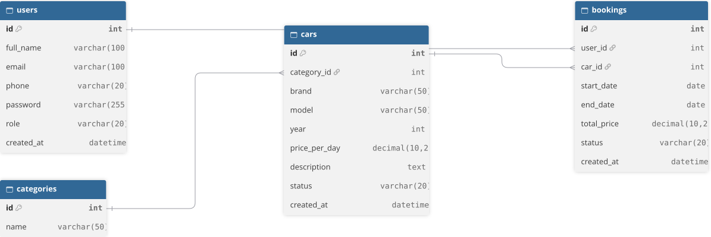
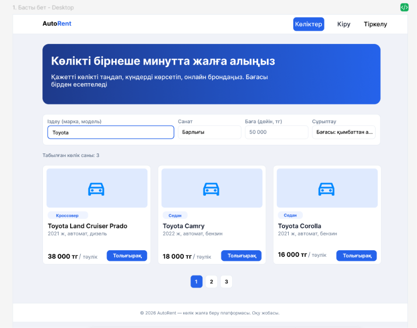

# AutoRent — көлік жалға беру платформасы

PHP және MySQL қолданып жасалған веб-қосымша. Пайдаланушылар көліктер каталогын көріп, қажетті күндерге көлікті брондай алады. Әкімші (admin) көліктер мен брондауларды басқарады.

> Жеке жобалық тапсырма, PHP курсы. Жоба 8 аптаға созылады (8–15 апта).

## Жобаның мақсаты

Көлік жалға беру процесін автоматтандыру: көліктер каталогын жүргізу, күндер бойынша брондау, күндердің қиылысуын тексеру және жалдау бағасын автоматты есептеу.

## Технологиялар

- **Frontend:** HTML, CSS, JavaScript
- **Backend:** PHP 8 (PDO)
- **Дерекқор:** MySQL
- **Орта:** XAMPP (локальды), InfinityFree (хостинг)

## Негізгі мүмкіндіктер

- Тіркелу, кіру және шығу (парольдер `password_hash()` арқылы сақталады)
- Көліктерді қосу, көрсету, өңдеу және жою (CRUD, тек admin)
- Көлікті күндер аралығына брондау
- Бір көлікті қиылысатын күндерге екі рет брондауға жол бермеу
- Жалдау бағасын күн санына қарай автоматты есептеу
- Іздеу (марка/модель), сүзу (санат, баға, бос күндер) және сұрыптау, пагинация
- Рөлдер: `user` (клиент) және `admin` (әкімші)
- Валидация және қауіпсіздік (prepared statements, `htmlspecialchars()`)
- Қосымша функция: 14-аптада нақтыланады (мысалы, көлік суретін жүктеу)

## Беттер тізімі

| № | Бет | Файл | Сипаттамасы |
|---|-----|------|-------------|
| 1 | Басты бет | `index.php` | Көліктер каталогы, іздеу, сүзу, сұрыптау, пагинация |
| 2 | Көлік беті | `car.php` | Толық ақпарат, бағасы, брондау формасы |
| 3 | Тіркелу | `register.php` | Жаңа пайдаланушыны тіркеу |
| 4 | Кіру | `login.php` | Жүйеге кіру |
| 5 | Менің брондауларым | `my_bookings.php` | Өз брондаулары, бас тарту |
| 6 | Көлік қосу | `add_car.php` | Жаңа көлік қосу (admin) |
| 7 | Көлікті өңдеу | `edit_car.php` | Көлік деректерін өзгерту (admin) |
| 8 | Барлық брондаулар | `bookings.php` | Барлық брондауларды басқару (admin) |
| 9 | Профиль | `profile.php` | Пайдаланушы деректері |

## Дерекқор құрылымы (ER-диаграмма)

## Figma Design

[Figma-да ашу](https://www.figma.com/design/CMQJhiobwQHJI9VfpKabSP/Untitled?node-id=0-1&t=ho3NRs5OKMJ0PIHw-1)

**Кестелер мен байланыстар:**
- `users` — пайдаланушылар (рөлі: `user` немесе `admin`).
- `categories` — көлік санаттары (эконом, кроссовер, премиум т.б.).
- `cars` — көліктер. Бір санатта көп көлік болады (`categories` 1 : N `cars`).
- `bookings` — брондаулар. Бір пайдаланушыда көп брондау болады (`users` 1 : N `bookings`), бір көлікте де көп брондау болады (`cars` 1 : N `bookings`).

## Жоба жоспары

| Апта | Тақырып | Нәтиже |
|------|---------|--------|
| 8 | Жоспарлау және репозиторий | README, беттер тізімі, ER-диаграмма |
| 9 | Frontend | Кемінде 3 статикалық бет |
| 10 | PHP негіздері | PHP беттері, жұмыс істейтін форма |
| 11 | Дерекқор және аутентификация | Тіркелу, кіру, шығу |
| 12 | CRUD | Көліктермен толық CRUD |
| 13 | Мәліметтермен жұмыс | Іздеу, сүзу, сұрыптау, пагинация, брондау логикасы |
| 14 | Қосымша функция және қауіпсіздік | Қосымша функция, қауіпсіздік тексерісі |
| 15 | Тестілеу, хостинг, қорғау | Хостингтегі жоба, есеп, қорғау |

## Апталық есептер

### 8-апта: Жоспарлау және репозиторий

**Орындалған жұмыс**
- Жоба тақырыбы таңдалды: AutoRent, көлік жалға беру платформасы. Мақсаты мен негізгі мүмкіндіктері сипатталды.
- Беттер тізімі жасалды (9 бет).
- Дерекқор құрылымы (ER-диаграмма) сызылды: `users`, `categories`, `cars`, `bookings` кестелері және олардың арасындағы байланыстар.
- GitHub-та репозиторий ашылды, README жазылды.

**Жобаның күйі:** ~10%

**Мәселелер және шешімдері:** елеулі мәселе болған жоқ.

**Келесі аптаға жоспар:** Figma-да макет жасау, HTML/CSS/JavaScript интерфейсін іске асыру.

**GitHub:** [коммиттер тарихы](https://github.com/Aselya23/AutoRent/commits/main)

### 9-апта: Пайдаланушы интерфейсі (frontend)

**Орындалған жұмыс**
- Figma-да негізгі экрандардың макеті жасалды: басты бет (каталог), кіру, тіркелу, көлік беті.
- HTML, CSS және JavaScript көмегімен адаптивті интерфейс іске асырылды: басты бет, кіру және тіркелу формалары.
- JavaScript арқылы көліктерді іздеу, санат және баға бойынша сүзу, сұрыптау, көлік санын көрсету жасалды.
- Телефон, планшет және компьютер экрандарына арналған адаптивті стильдер қосылды.

**Жобаның күйі:** ~25%

**Мәселелер және шешімдері:** Figma-да бет (Frame) мөлдірлігі кездейсоқ 10%-ға түсіп кетті, Opacity мәнін 100% қылып түзеттім.

**Келесі аптаға жоспар:** беттерді PHP файлдарына көшіру, `include` арқылы header/footer бөлу, формаларды өңдеу.

**GitHub:** [коммиттер тарихы](https://github.com/Aselya23/AutoRent/commits/main)

### 10-апта: PHP негіздері және серверлік құрылым

**Орындалған жұмыс**
- Статикалық беттер PHP-ге көшірілді: `index.php`, `car.php`, `login.php`, `register.php`.
- Қайталанатын бөліктер `include` арқылы бөлінді: `includes/header.php`, `includes/footer.php`. Уақытша деректер мен көмекші функциялар `includes/data.php` ішінде.
- Іздеу, санат бойынша сүзу және сұрыптау `$_GET` арқылы жұмыс істейді, көлік беті `car.php?id=` арқылы ашылады.
- Тіркелу, кіру және брондау формалары `$_POST` арқылы өңделеді, деректер сервер жағында тексеріледі (email, телефон, құпиясөз, брондау күндері).
- Экранға шығатын мәтін `htmlspecialchars()` арқылы қорғалды (XSS).
- Жоба XAMPP (Apache) арқылы `localhost`-та тексерілді.

**Жобаның күйі:** 40%

### 11-апта: MySQL дерекқоры және аутентификация

**Орындалған жұмыс**
- MySQL-де autorent дерекқоры мен 4 кесте құрылды: users, categories, cars, bookings (ER-диаграммаға сай). Кестелерге сыртқы кілттер (FOREIGN KEY) қосылды, users кестесінде email бағаны UNIQUE.
- cars кестесіне ER-диаграммада жоқ transmission, fuel, seats бағандары қосылды, себебі сайтта олар көрсетіледі. Кестелерге 4 санат пен 9 көлік енгізілді.
- includes/db.php файлында PDO арқылы қосылу жасалды (prepared statements, ерекше жағдайларды өңдеу).
- Тіркелу: деректер сервер жағында тексеріледі, email қайталануы тексеріледі, құпиясөз password_hash() арқылы шифрланып, users кестесіне сақталады.
- Кіру: password_verify() арқылы құпиясөз тексеріледі, session_start() және session_regenerate_id() қолданылады, сессияда пайдаланушы ID-і, аты және рөлі сақталады.
- Шығу (logout.php) және жабық бет (profile.php): кірмеген адам login.php бетіне бағытталады. Header-де кірген пайдаланушының аты мен «Шығу» түймесі көрсетіледі.
- Каталог (index.php) және көлік беті (car.php) көліктерді енді дерекқордан алады. Іздеу, санат және баға бойынша сүзу SQL-сұрау арқылы жұмыс істейді.
- Брондау формасы тек жүйеге кірген пайдаланушыға ашық, күндер сервер жағында тексеріледі, жалпы сома есептеледі.

**Жобаның қазіргі күйі:** шамамен 55%.

**Кездескен мәселелер және шешімдері**
- XAMPP-та MySQL порты (3306) бос емес болды: басқа MySQL80 қызметі мен фонда қалған mysqld процесі ұстап тұрды. Қызметті қолмен іске қосылатын режимге ауыстырып, процесті Диспетчер задач арқылы тоқтатып шештім.
- Компьютерде бірнеше XAMPP көшірмесі болып, файлдар мен дерекқор әртүрлі көшірмеде қалып қойды. Жұмыс істеп тұрған XAMPP-тың htdocs қалтасын тауып, дерекқорды сол жерде қайта құрып шештім.
- Unknown database 'autorent' қатесі шықты, дерекқорды қайта құрып түзеттім.

**Келесі аптаға жоспар (12-апта)**
- Көліктермен CRUD: қосу (add_car.php), өңдеу (edit_car.php), жою (тек admin).
- Брондауларды bookings кестесіне сақтау.
- Өз брондауларын көру (my_bookings.php).

**GitHub:** [коммиттер тарихы](https://github.com/Aselya23/AutoRent/commits/main)

## Автор

- Aselya23
