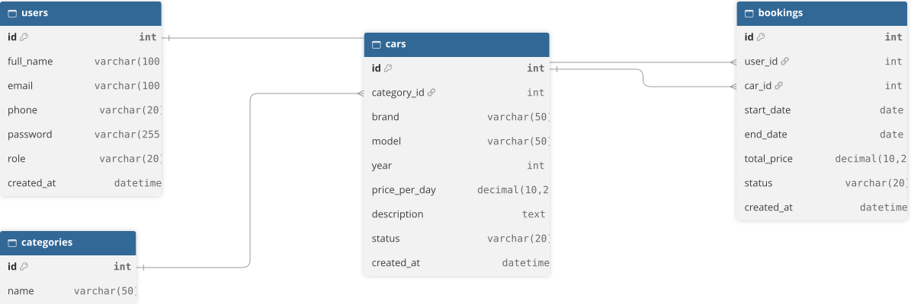
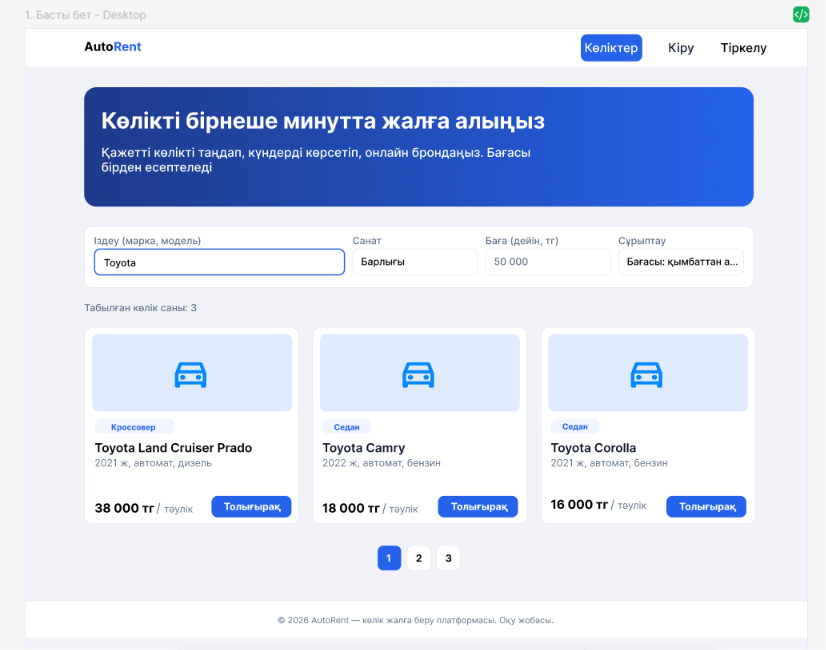

# AutoRent — көлік жалға беру платформасы

PHP және MySQL қолданып жасалған веб-қосымша. Пайдаланушылар көліктер каталогын көріп, қажетті күндерге көлікті брондай алады. Әкімші (admin) көліктер мен брондауларды басқарады.

> Жеке жобалық тапсырма, PHP курсы. Жоба 8 аптаға созылады (8–15 апта).

## Жобаның мақсаты

Көлік жалға беру процесін автоматтандыру: көліктер каталогын жүргізу, күндер бойынша брондау, күндердің қиылысуын тексеру және жалдау бағасын автоматты есептеу.

## Технологиялар

- **Frontend:** HTML, CSS, JavaScript
- **Backend:** PHP 8 (PDO)
- **Дерекқор:** MySQL
- **Орта:** XAMPP (локальды), InfinityFree (хостинг)

## Негізгі мүмкіндіктер

- Тіркелу, кіру және шығу (парольдер `password_hash()` арқылы сақталады)
- Көліктерді қосу, көрсету, өңдеу және жою (CRUD, тек admin)
- Көлікті күндер аралығына брондау
- Бір көлікті қиылысатын күндерге екі рет брондауға жол бермеу
- Жалдау бағасын күн санына қарай автоматты есептеу
- Іздеу (марка/модель), сүзу (санат, баға, бос күндер) және сұрыптау, пагинация
- Рөлдер: `user` (клиент) және `admin` (әкімші)
- Валидация және қауіпсіздік (prepared statements, `htmlspecialchars()`)
- Қосымша функция: 14-аптада нақтыланады (мысалы, көлік суретін жүктеу)

## Беттер тізімі

| № | Бет | Файл | Сипаттамасы |
|---|-----|------|-------------|
| 1 | Басты бет | `index.php` | Көліктер каталогы, іздеу, сүзу, сұрыптау, пагинация |
| 2 | Көлік беті | `car.php` | Толық ақпарат, бағасы, брондау формасы |
| 3 | Тіркелу | `register.php` | Жаңа пайдаланушыны тіркеу |
| 4 | Кіру | `login.php` | Жүйеге кіру |
| 5 | Менің брондауларым | `my_bookings.php` | Өз брондаулары, бас тарту |
| 6 | Көлік қосу | `add_car.php` | Жаңа көлік қосу (admin) |
| 7 | Көлікті өңдеу | `edit_car.php` | Көлік деректерін өзгерту (admin) |
| 8 | Барлық брондаулар | `bookings.php` | Барлық брондауларды басқару (admin) |
| 9 | Профиль | `profile.php` | Пайдаланушы деректері |

## Дерекқор құрылымы (ER-диаграмма)

## Figma Design

[Figma-да ашу](https://www.figma.com/design/CMQJhiobwQHJI9VfpKabSP/Untitled?node-id=0-1&t=ho3NRs5OKMJ0PIHw-1)
**Кестелер мен байланыстар:**
- `users` — пайдаланушылар (рөлі: `user` немесе `admin`).
- `categories` — көлік санаттары (эконом, кроссовер, премиум т.б.).
- `cars` — көліктер. Бір санатта көп көлік болады (`categories` 1 : N `cars`).
- `bookings` — брондаулар. Бір пайдаланушыда көп брондау болады (`users` 1 : N `bookings`), бір көлікте де көп брондау болады (`cars` 1 : N `bookings`).

## Жоба жоспары

| Апта | Тақырып | Нәтиже |
|------|---------|--------|
| 8 | Жоспарлау және репозиторий | README, беттер тізімі, ER-диаграмма |
| 9 | Frontend | Кемінде 3 статикалық бет |
| 10 | PHP негіздері | PHP беттері, жұмыс істейтін форма |
| 11 | Дерекқор және аутентификация | Тіркелу, кіру, шығу |
| 12 | CRUD | Көліктермен толық CRUD |
| 13 | Мәліметтермен жұмыс | Іздеу, сүзу, сұрыптау, пагинация, брондау логикасы |
| 14 | Қосымша функция және қауіпсіздік | Қосымша функция, қауіпсіздік тексерісі |
| 15 | Тестілеу, хостинг, қорғау | Хостингтегі жоба, есеп, қорғау |

## Автор

- Aselya23
